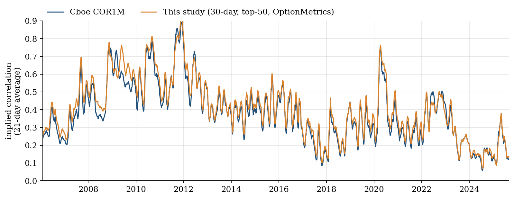
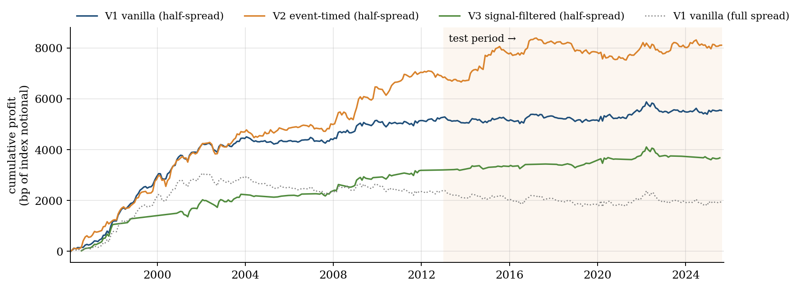
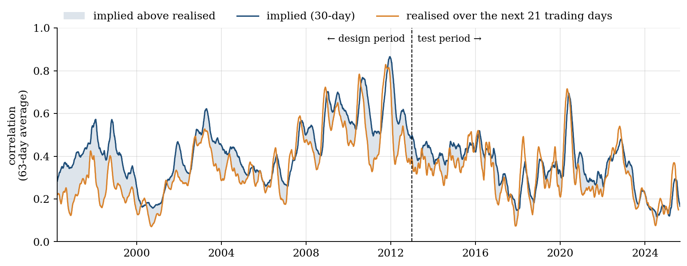
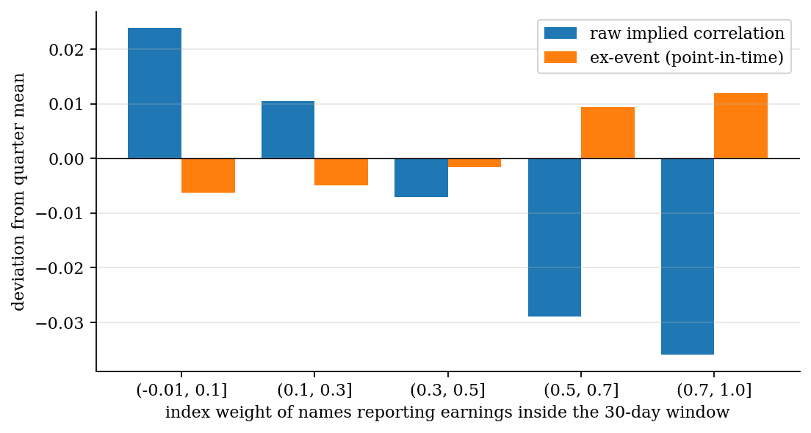
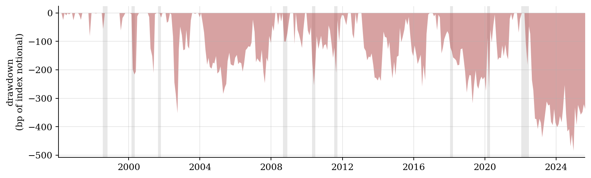

Event-Variance Decomposition of Implied Correlation: Macro Co-Jumps, Earnings Jumps and Theta-Weighted Dispersion

Kenneth Anthony WijayaSubmitted 21 October 2026

# 1. Hypothesis Pitch

Index options are persistently expensive relative to their constituents. The implied correlation of the S&P 500, recovered from SPX and single-stock option prices, has historically exceeded the correlation subsequently realised (Driessen, Maenhout and Vilkov, 2009), and dispersion trading (selling index volatility and buying constituent volatility) is the standard way to harvest the gap. This project argues that a material part of the premium, and almost all of its calendar variation, reflects *scheduled-event variance* rather than compensation for diffusive correlation risk.

The mechanism follows from how option prices aggregate information. A stock's 30-day implied variance is the sum of diffusive variance and the variance of any jump scheduled before expiry; that jump is known in advance, priced and resolved on a known date (Bennett, 2014, §6.4; Dubinsky *et al.*, 2019). Because implied correlation is a ratio of index variance to constituent variance, any event that loads one side more heavily than the other moves the measured correlation without any change in genuine co-movement. Two cases follow. Earnings announcements are idiosyncratic jumps that inflate single-stock variance far more than index variance, so implied correlation should fall mechanically when an option's life spans an earnings season. Macroeconomic releases (FOMC decisions, CPI) are co-jumps that strike all stocks together, so implied correlation should rise when they fall inside the window. Three hypotheses were pre-registered: (H1) the calendar pattern exists and disappears once event variance is removed; (H2) the correlation premium differs between the raw and the ex-event measures; (H3) event-timed dispersion outperforms vanilla monthly dispersion out of sample, net of bid–ask costs.

The idea arose while I was preparing for a quantitative-research interview on correlation trading. Working through Bennett's §6.3, I found that his shortcut approximations to implied correlation carry a regime-dependent bias, which raised the broader question of what else contaminates the number that dispersion desks trade.

**Falsification.** H1 fails if raw and ex-event implied correlation display the same calendar pattern. H3 fails if event-timed and vanilla dispersion are statistically indistinguishable out of sample, or if any advantage disappears at realistic transaction costs. Both criteria were recorded in `research_log.md` before any result was computed.

# 2. Data Pipeline

## 2.1 Sources and acquisition

The study covers 2 January 1996 to 29 August 2025 (7,465 trading days), the full span of OptionMetrics data available under Imperial's WRDS subscription. Table 1 summarises the inputs.

| Data | Source and access | Role in the study |
|:---|:---|:---|
| Daily prices, total returns and split factors (`secprd`) | OptionMetrics, WRDS (authenticated, scripted) | Realised volatility, delta hedging, payoffs |
| Standardised at-the-money implied volatilities, 10–91 days (`stdopd`) | OptionMetrics, WRDS | Implied correlation; event-variance decomposition |
| Option chains with bid, offer, IV and Greeks on 356 entry dates (`opprcd`) | OptionMetrics, WRDS | Straddle prices at executable quotes |
| Historical S&P 500 membership; prices × shares (`msp500list`, `dsf`) | CRSP, WRDS | Survivorship-free top-50 basket and weights |
| Dated PERMNO–SECID link (`opcrsphist`) | WRDS link table | Joining CRSP to OptionMetrics |
| Earnings report dates (`rdq`) | Compustat (CCM-linked), WRDS | Earnings calendar |
| FOMC meeting dates | Federal Reserve website (scraped) | Macro calendar |
| CPI and payroll release dates; three-month T-bill | FRED API (authenticated) | Macro calendar; risk-free rate |
| COR1M, COR3M, VIX | Cboe public files | Validation and risk diagnostics |

Table: **Table 1.** Data sources.

Every source is retrieved by code. `wrds_extract.py` connects through the `wrds` package with credentials held in the user's own `pgpass` file, and the FRED key is read from an environment variable; no credential appears in any submitted file. Queries are filtered on the server (SPX and basket members only; expiries within 70 days; 0.2 ≤ |Δ| ≤ 0.8) and option chains are requested only on the monthly entry dates the strategy uses, which reduces the option data to 1.6 million quotes. The extraction is resumable, and every raw file is logged in a manifest recording its source, download time, row count and SHA-256 hash. A free-data pipeline (Yahoo Finance, DoltHub, SEC EDGAR) built before WRDS access was granted is retained in the notebook as an independent cross-check for 2019–2025.

## 2.2 Cleaning and data integrity

Real-world irregularities were corrected rather than discarded. OptionMetrics codes missing returns as −99.99; these were set to missing. Prices are restated in entry-date units using the cumulative adjustment factor, so a split during a holding period cannot corrupt a hedge or a payoff, and the hedge accrues total returns so that a short stock position correctly pays dividends. The 30-day volatility of each name averages the call and put standardised IVs, which removes put–call parity noise. Option quotes with a zero bid, a crossed market or a spread wider than the mid were removed (6,563 of 1.63 million). SPX monthly options settle on the Friday opening print, so index payoffs use that price and the hedge is unwound there. Where a stock stopped trading before expiry, as after a cash merger, the position is settled at the last available price rather than dropped (16 of 17,925 legs). Share classes of the same company, such as GOOG and GOOGL, are merged through the CRSP company identifier.

The event calendars required particular care. FRED's 'FOMC Press Release' series proved to be a near-daily data release with roughly 2,900 dates rather than a meeting calendar, so decision dates were instead parsed from the Federal Reserve's own meeting pages. The resulting calendar contains exactly eight scheduled decisions in every full year except 2020, when the March meeting was cancelled. CPI release dates were validated at twelve per year.

## 2.3 Validation of the core measure

Implied correlation is constructed from the exact equicorrelation identity

$$\rho_{\text{imp}} = \frac{\sigma_I^2 - \sum_i w_i^2 \sigma_i^2}{\left(\sum_i w_i \sigma_i\right)^2 - \sum_i w_i^2 \sigma_i^2},$$

where $\sigma_I$ is the SPX 30-day implied volatility, $\sigma_i$ the constituent volatilities and $w_i$ the point-in-time capitalisation weights. Cboe computes its COR1M index independently, from listed options under its own methodology, and the series constructed here tracks it closely: the correlation is 0.984 in levels and 0.934 in daily changes, with a mean gap of 2.4 correlation points (Figure 1). The 91-day measure against COR3M gives 0.984 and 0.912 respectively.

# 3. Strategy and Backtest

## 3.1 Design

On the first trading day after each standard monthly expiry, the book sells at-the-money SPX straddles worth \$1 of index notional and buys at-the-money straddles on each of the point-in-time top-50 companies. Constituent notionals are proportional to index weights and scaled so that the theta of the long leg equals that of the short leg. This is Bennett's theta-weighted dispersion, whose profit is approximately $\sum_i w_i \sigma_i^2 (\rho_{\text{imp}} - \rho_{\text{real}})$. Positions are held to the next monthly expiry (20–45 calendar days) and every straddle is delta-hedged at each close using Black–Scholes deltas at its entry volatility.

Options are executed at the mid plus a fraction $c$ of the quoted half-spread on every leg, with $c \in \{0, 0.5, 1\}$; $c = 0.5$ is the central case. Hedge trades cost 1 bp of turnover for stocks and 0.5 bp for the index, and premia are financed at the three-month T-bill rate. Profit is measured in basis points of index notional per non-overlapping monthly holding period. Because the book is sized on fixed notional rather than reinvested capital, cumulative return is the sum of monthly profits.

Three variants were pre-registered. V1 trades every month. V2, the event-timed book, holds long single-stock straddles only on names whose recorded report date falls within the holding period. V3, the signal-filtered book, trades V1 only when the point-in-time ex-event implied correlation exceeds its trailing one-year median.

## 3.2 Results

Table 2 reports the central-case performance. The design period (1996–2012) was used for all development; the test period (January 2013 to August 2025) was evaluated once.

| Variant | Sample | Months | Cumulative (bp) | Mean per month (bp) | Sharpe (annualised) | Max drawdown (bp) | *t*-statistic | Deflated Sharpe |
|:---|:---|---:|---:|---:|---:|---:|---:|---:|
| V1 Vanilla | In-sample | 204 | +5,270 | +25.8 | 1.17 | −352 | 4.84 | 1.00 |
| | Out-of-sample | 152 | +269 | +1.8 | 0.10 | −484 | 0.35 | 0.49 |
| V2 Event-timed | In-sample | 192 | +6,835 | +35.6 | 1.16 | −454 | 4.65 | 1.00 |
| | Out-of-sample | 152 | +1,272 | +8.4 | 0.30 | −863 | 1.07 | 0.77 |
| V3 Signal-filtered | In-sample | 99 | +3,200 | +32.3 | 1.33 | −299 | 3.82 | 1.00 |
| | Out-of-sample | 69 | +474 | +6.9 | 0.32 | −502 | 0.77 | 0.70 |

Table: **Table 2.** Performance at half-spread execution costs.

The in-sample results are strong and statistically unambiguous; the out-of-sample results are not. Every variant loses most of its performance after 2012 (Figure 2), and none survives correction for multiple testing: the Deflated Sharpe Ratios of 0.49–0.77 fall well short of the conventional 0.95 threshold. Cost sensitivity sharpens the conclusion (Table 3). V1 is profitable only if execution costs stay below 69% of the quoted half-spread, whereas V2 remains profitable even at full spread.

| Out-of-sample | V1 | V2 | V3 |
|:---|---:|---:|---:|
| Sharpe ratio at mid | 0.37 | 0.49 | 0.62 |
| Sharpe ratio at full spread | −0.17 | 0.12 | 0.04 |
| Break-even cost (multiple of quoted half-spread) | 0.69 | 1.34 | 1.07 |

Table: **Table 3.** Sensitivity of out-of-sample performance to execution costs.

## 3.3 Mechanism tests

Table 4 reports the measurement results behind H1 and H2. Coefficients come from regressions of implied correlation on the contents of its 30-day window, with quarter fixed effects and Newey–West standard errors (21 lags).

| | Design 1996–2012 | Test 2013–2025 |
|:---|:---|:---|
| Correlation risk premium, raw | +0.079 (*t* = 10.2) | +0.025 (*t* = 2.9) |
| Correlation risk premium, ex-event | +0.062 (*t* = 6.7) | +0.007 (*t* = 0.8) |
| Earnings weight in window: effect on raw $\rho_{\text{imp}}$ | −0.060 (*t* = −6.5) | −0.114 (*t* = −8.4) |
| Earnings weight in window: effect on ex-event $\rho_{\text{imp}}$ | +0.048 (*t* = 3.7) | −0.010 (*t* = −0.7) |
| FOMC decision in window: effect on raw $\rho_{\text{imp}}$ | −0.001 (*t* = −0.2) | +0.003 (*t* = 0.4) |
| Share of 30-day SPX implied variance resolved on an FOMC / CPI day | 6.1% / 2.8% | 3.9% / 3.3% |

Table: **Table 4.** Calendar effects and the correlation risk premium.

## 3.4 Interpretation

H1 is half supported. Raw implied correlation falls by 6 points in the design period and 11 points in the test period when the entire basket reports within the window, and removing the measured earnings-jump variance eliminates the effect out of sample (Figure 4). The in-sample correction overshoots slightly, which Section 4 attributes to the smoothing in standardised volatilities. The macroeconomic half of H1 is rejected: implied correlation does not rise across FOMC or CPI windows. The decomposition explains why. A scheduled FOMC decision resolves 4–6% of the index's 30-day implied variance, but the same pooled regression shows that it also resolves 2–3% of each constituent's. Macro releases are therefore genuine co-jumps that scale both sides of the ratio and leave it almost unchanged, a result that the original hypothesis did not anticipate.

H2 receives a clear answer. Figure 3 shows the premium narrowing markedly after 2012. In the test period the raw premium is 2.5 correlation points and significant, whereas the ex-event premium is 0.7 points and indistinguishable from zero. The premium available after 2012 is, in effect, a premium for bearing event variance.

H3 is not supported under the pre-registered criterion. The ordering of the variants is consistent with H2: the event-timed book outperforms vanilla dispersion out of sample (Sharpe ratio 0.30 against 0.10; break-even cost 1.34 against 0.69 half-spreads). The difference is not statistically significant, however, and two of the three variants lose money at full spread. The decay is visible in the attribution: the short index leg earned 44 bp per month before 2013 and 1.9 bp afterwards. This pattern is consistent with the expansion of systematic dispersion products after the financial crisis, although the present design cannot identify crowding directly.

# 4. Methodology Defense

**Universe.** The top fifty S&P 500 companies by CRSP market capitalisation, rebalanced quarterly, replicate the construction of Cboe's implied correlation indices. This choice is what gives the COR1M validation its force. These names also account for most of the index weight and carry the most liquid single-stock options, which matters when every leg is executed at quoted prices. Membership is point-in-time, and capitalisations are taken on the trading day before each rebalance. SPX options were preferred to SPY options for their depth and their longer history. A broader universe would change the $\sum_i w_i^2 \sigma_i^2$ term only marginally but would add illiquid names whose spreads would dominate the profit.

**Sample split.** The design period, 1996–2012, contains the 2001 and 2008 crises and overlaps Driessen, Maenhout and Vilkov (2009), so the existence of the premium could be checked against an established benchmark before any strategy was built. The test period contains three distinct stress episodes (2018, 2020 and 2022) and the post-crisis growth in systematic dispersion. A single held-out block was preferred to walk-forward validation because the hypotheses are structural claims about option pricing rather than parameters requiring periodic re-estimation.

**Transaction costs.** Option spreads are the dominant cost: the median quoted half-spread is 2.7% of the straddle mid for SPX and 2.1% for single stocks. Institutional dispersion desks typically trade inside the quote, which motivates half of the half-spread as the central assumption. Mid and full-spread execution bracket that estimate, and the break-even fraction lets a reader apply any alternative. Hedging costs are an order of magnitude smaller and do not affect the conclusions.

**Event-variance estimation.** For single stocks, earnings-jump variance is estimated from two maturities on the day before the reaction day, when both the 30-day and 60-day options contain the announcement:

$$v_d = \frac{V_{60} - V_{30}}{30}, \qquad J^2 = V_{30} - 30\,v_d,$$

where $V_T = \sigma_T^2 \, T/365$ is total implied variance to maturity $T$ (Dubinsky *et al.*, 2019). The estimator assumes that no second announcement falls within 60 days, which holds for quarterly reporters. Its output is economically sensible: the median implied event move is 3.0% against a realised 2.8%, and the two correlate at 0.48. For the index, a pooled term-structure regression was attempted first. It returned estimates outside the admissible range, because event counts are almost proportional to maturity and the diffusive term structure is not flat. It was replaced, before any strategy was run, by a volatility-crush regression in the spirit of Beber and Brandt (2006): the fall in 30-day implied variance on event days, relative to ordinary days, identifies each event's share of variance. The discarded method is recorded in the research log as a trial.

**Point-in-time construction.** The trading signal uses only information available at the decision date. Index event shares come from an expanding-window regression, and each stock's expected jump variance is the mean of its four previous estimates. The principal weakness of the decomposition lies in the data rather than the algebra. OptionMetrics' standardised volatilities are kernel-smoothed across expiries, so an announcement close to day 30 is only partly reflected in the 30-day volatility. Removing its full jump variance then over-corrects, which is the most plausible source of the modest in-sample overshoot.

**Theta-weighting and hedging.** Theta-weighting is market convention (Bennett, 2014, §6.3). By neutralising time decay, it ensures that profit arises from the difference between realised and implied variance on each leg rather than from carry. The cost is a net short vega position: the long leg's vega is a median 65% of the short leg's, an exposure treated explicitly in Section 7. Hedging at entry volatility, rather than at a re-marked surface, is standard for straddle attribution. The hedged profit then integrates $\tfrac{1}{2}\Gamma S^2(\sigma_{\text{real}}^2 - \sigma_{\text{imp}}^2)$, and an alternative hedging volatility alters path-dependence but not the expected outcome.

**Inference.** Daily regressions use Newey–West standard errors to account for overlapping 30-day windows, and quarter fixed effects prevent slow regime shifts in correlation from being mistaken for calendar effects. Strategy significance is assessed with the Deflated Sharpe Ratio (Bailey and López de Prado, 2014), which adjusts for the number of variants tried and for non-normal returns.

# 5. Pitfall Checklist

## Look-ahead bias

The basket in force on any date is the most recent quarterly rebalance on or before it, located by binary search and built from the previous day's capitalisations. FOMC and CPI dates are scheduled and published in advance. The V3 signal uses only expanding-window index estimates and each stock's previous jump estimates, all available at the entry close. Option prices are entry-date quotes, and payoffs use the expiry-day settlement price: the opening level for AM-settled SPX options and the close for single stocks. Two ex-post constructs exist in the code: the contemporaneous jump estimate used in the H1 regressions, and the reaction day, chosen as whichever of the report date and the following trading day shows the larger stock-minus-index move. An audit of this checklist against the code found that the first version of V2 and of the V3 signal placed announcements on the reaction day, which uses realised returns. Both rules were corrected to use the recorded report date, without changing any parameter, and the correction is logged as Amendment 3 in the research log. It altered 267 of 17,569 name-month assignments (1.5%) and moved the out-of-sample Sharpe ratios of V2 and V3 from 0.28 and 0.29 to 0.30 and 0.32; the ex-post timing had therefore conferred no advantage. Both constructs are now confined to measurement.

One residual risk remains. V2 relies on Compustat's recorded report date, whereas a trader would have used the date pre-announced by the company, normally two to four weeks ahead. The recorded dates are demonstrably the true event dates (the median stock-minus-index move on the reaction day is 2.68%, against 0.72% on a random day), and V2 requires only that the announcement fall somewhere within a four-week holding period. The bias is therefore likely to be small, but a clean test would require historical pre-announced calendars from I/B/E/S or a similar vendor.

## Survivorship bias

The universe is not a fixed list. Eligibility is drawn from CRSP's historical membership table, which includes companies later acquired, delisted or bankrupt, and 161 distinct companies pass through the top fifty over the sample (the original AT&T Corp., the second-largest name in January 1996 and acquired in 2005, is one example). The dated PERMNO–SECID link preserves price histories through ticker changes and share-class reorganisations. Positions in stocks that cease trading mid-holding are settled at their last price rather than dropped. Using today's constituents instead would remove precisely the firms whose straddles tended to pay off through large jumps, understating the long leg and biasing dispersion profit downwards.

## Overfitting/data-snooping

Hypotheses, falsification criteria, the sample split, all three variants and every threshold were recorded in `research_log.md` before any result was computed. The thresholds (80% weight coverage, a 20–45 day expiry window, a one-year median filter, a four-quarter jump average) are round ex-ante choices; no parameter search was run. In total, three strategy variants and one discarded measurement method were tried, and the test period was evaluated once with no subsequent changes. The Deflated Sharpe Ratio, which adjusts for these trials and for skewness and kurtosis, is close to 1.00 in sample but only 0.49–0.77 out of sample. The out-of-sample edge does not survive selection correction.

## Transaction costs and slippage

Options are executed at the mid plus a fraction of the quoted half-spread on every leg and side, hedges pay 1 bp (stocks) or 0.5 bp (index) of traded notional, and premia are financed at the T-bill rate. In sample, the strategy survives even full-spread execution (V1 Sharpe ratio 0.54; break-even at 1.4 half-spreads). Out of sample it does not: V1's Sharpe ratio falls from 0.37 at mid to −0.17 at full spread, and only V2 tolerates more than the full quoted spread. Two frictions are omitted: the market impact of trading 51 option lines each month, and the widening of spreads during stress. Both would raise realistic costs, so the conclusion that no reliable edge survives is, if anything, conservative.

## Out-of-sample validation

January 2013 to August 2025 (152 monthly trades) was excluded from all design work. Relative to the in-sample period, V1's Sharpe ratio fell from 1.17 to 0.10 and its mean monthly profit from 25.8 bp to 1.8 bp; V2 fell from 1.16 to 0.30 and V3 from 1.33 to 0.32. The measurement findings, by contrast, replicate: the earnings-season fall in raw implied correlation is stronger out of sample (*t* = −8.4) and the ex-event correction removes it entirely. The economic mechanism therefore persists while the tradeable premium has largely disappeared, which is consistent with the H2 finding that the remaining premium is event variance.

# 6. Efficiency Touchpoint

The most expensive step is the conversion of option chains into hedged straddle profit. A naive implementation would retrieve the complete daily option surface for every constituent, of the order of 7,465 days × 50 names × 100–400 quotes, or $10^8$ to $10^9$ rows, and re-scan it each day to revalue positions. Two design decisions avoid this. Holding every position to expiry means that only entry-date chains are required (356 dates rather than 7,465), and filtering on the server reduces the extraction to 1.6 million rows. Each leg's daily hedge is then vectorised along its own path, so pricing scales as $O(S \cdot H)$, with $S$ = 17,925 legs and $H \approx 20$ days: roughly $3.6 \times 10^5$ hedge steps, completed in about 14 seconds.

The classic quadratic step is implied correlation itself. The pairwise sum $\sum_{i \neq j} w_i w_j \sigma_i \sigma_j$ is replaced by the exact identity $\left(\sum_i w_i \sigma_i\right)^2 - \sum_i w_i^2 \sigma_i^2$, reducing the daily cost from $O(n^2)$ to $O(n)$. Measured in the notebook, a Python double loop takes 0.55 ms per day at $n = 50$ (about 4 seconds over the sample) and would take 410 seconds at $n = 500$, whereas the vectorised identity processes the entire 7,465-day panel in 36 ms. At fifty names the naive approach would have been tolerable; the identity becomes necessary if the method is extended to the full index or to intraday data. Prefix sums make the rolling and expanding event-variance regressions $O(1)$ per day, and binary search counts the events inside each option window in $O(N \log E)$ time, around 370 times faster than a linear scan.

# 7. Risk Touchpoint

Each month the book is short \$1 of SPX straddle notional against about fifty theta-matched long single-stock straddles. It is net short vega (the long-to-short vega ratio has a median of 0.65 and a 5–95% range of 0.47–0.86), short volga and short correlation. The index leg's loss is unbounded in a crash, so a production version would cap index notional at a volatility-targeted fraction of capital. Diversification is largely illusory: fifty names enter the book, but its profit is driven by a single factor, the change in average correlation, and capitalisation weighting concentrates the long leg further (the five largest names carried 24% of the weight in 1996 and 45% in July 2025).

The relevant adverse scenario is a correlation spike. Monthly profit has a beta of −0.015 to the change in implied correlation over the holding period (*t* = −4.7), and the worst months were March 2000 (−194 bp) and March 2020 (−178 bp). Across named stress episodes, V1 lost 211 bp around the dot-com peak, 131 bp in the 2010 flash crash and 71 bp during the Lehman collapse (86 bp for V2). Crashes are not uniformly harmful, because long single-stock gamma pays when the dispersion of returns rises with volatility: the book gained 216 bp during COVID and 292 bp in the 2022 rate shock (Figure 5). The more serious threat is liquidity. Single-stock spreads widen exactly when positions must be rebalanced, and with an out-of-sample break-even of only 0.7–1.3 half-spreads, a doubling of spreads under stress would turn a marginal strategy into a losing one.

# 8. Reflection

The project changed my understanding of what implied correlation measures. I had treated it as a price of correlation risk; the evidence shows that its calendar variation is dominated by idiosyncratic earnings variance in the single-stock legs, and that removing this variance leaves a series with no detectable seasonal pattern out of sample. I expected macroeconomic announcements to raise implied correlation, and they do not. That expectation ignored the fact that a true co-jump raises the variance of every component at the same time. The volatility-crush regression also proved a more reliable way to measure event variance in a heavily traded index than the term-structure algebra I began with, which failed for reasons that were only apparent once it was applied to real data.

Several assumptions proved wrong in ways that only implementation revealed. A strong in-sample dispersion premium does not persist: it decayed to almost nothing after 2012, and what remains is event variance. Data mattered more than modelling. Free sources could not support a study beginning in 1996 with executable prices, and obtaining WRDS access and rebuilding the pipeline around it was the most consequential decision in the project. Two errors would have survived a less careful approach. The first backtest unwound SPX hedges at the Friday close, even though the options settle at the open, and this materially mis-measured crash months. The second was the FRED 'FOMC Press Release' series, which turned out not to be a meeting calendar.

The natural extensions follow from the weaknesses identified. Exact announcement timestamps (before or after the open, from I/B/E/S or RavenPack) and actual listed expiries would remove the smoothing behind the in-sample over-correction. The event premium could be traded directly with weekly options expiring just after an earnings date or an FOMC decision, isolating the jump leg rather than diluting it in monthly dispersion. Any move towards production would require volatility-targeted sizing, explicit loss limits and a market-impact model. Finally, applying the method to sector-ETF dispersion or to the Euro Stoxx 50, where the macro calendar and earnings timing differ, would test whether the decomposition generalises beyond US large caps. The mechanism is real and replicates; the tradeable edge, after realistic costs, does not.

# References

Bailey, D.H. and López de Prado, M. (2014) 'The deflated Sharpe ratio: correcting for selection bias, backtest overfitting and non-normality', *Journal of Portfolio Management*, 40(5), pp. 94–107.

Beber, A. and Brandt, M.W. (2006) 'The effect of macroeconomic news on beliefs and preferences: evidence from the options market', *Journal of Monetary Economics*, 53(8), pp. 1997–2039.

Bennett, C. (2014) *Trading Volatility: Trading Volatility, Correlation, Term Structure and Skew*. CreateSpace Independent Publishing Platform.

Cboe Global Markets (n.d.) *Cboe Implied Correlation Indices (COR1M, COR3M): methodology and historical data*. Chicago: Cboe.

Driessen, J., Maenhout, P.J. and Vilkov, G. (2009) 'The price of correlation risk: evidence from equity options', *Journal of Finance*, 64(3), pp. 1377–1406.

Dubinsky, A., Johannes, M., Kaeck, A. and Seeger, N.J. (2019) 'Option pricing of earnings announcement risks', *Review of Financial Studies*, 32(2), pp. 646–687.

Newey, W.K. and West, K.D. (1987) 'A simple, positive semi-definite, heteroskedasticity and autocorrelation consistent covariance matrix', *Econometrica*, 55(3), pp. 703–708.

*Data:* OptionMetrics IvyDB US, CRSP and Compustat, accessed through Wharton Research Data Services; Board of Governors of the Federal Reserve System, FOMC meeting calendars; Federal Reserve Bank of St. Louis, FRED.
